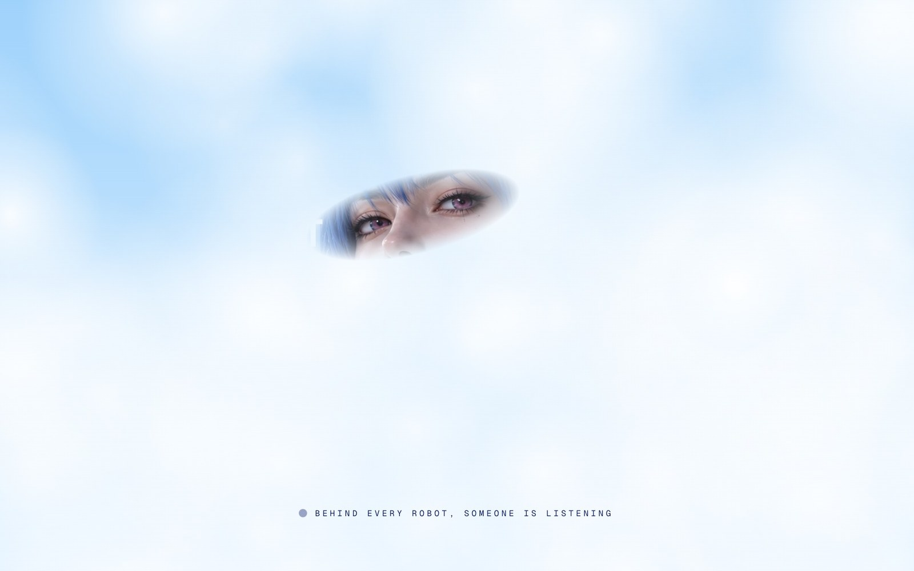

<p align="center">
  <a href="https://bruhos.ai"></a>
</p>

<h1 align="center">bruhOS</h1>

<p align="center"><b>The skill OS that stands next to the robot.</b><br/>
Runs like your bruhhh.</p>

<p align="center">
  <a href="https://bruhos.ai">bruhos.ai</a> ·
  <a href="https://x.com/bruhos_ai">@bruhos_ai</a> ·
  <a href="docs/design.zh-CN.md">Design doc (中文)</a>
</p>

---

bruhOS is a partner OS for robots — it hears you, runs skills, and leaves a trace.

Open brains already exist: NVIDIA Isaac GR00T, Cosmos, Isaac Lab, Hugging Face LeRobot, openpi,
Qwen-VL. What's missing is the system **between the model and the body**. bruhOS plugs those brains
into a TonyPi humanoid as planners and data engines, while the robot itself only runs whitelisted
skills, speaks English, gets back up, and leaves a hashable trace.

Not a brain in the cloud. A bruh on the body.

## How it fits together

```
                    English command
                           │
                           ▼
              ┌────────────────────────┐
              │  bruhOS Brain          │
              │  planner adapters      │
              │  Qwen-VL / OpenAI API  │
              │  optional: GR00T S2    │
              │  optional: LeRobot svc │
              └────────────┬───────────┘
                           │ skill JSON
                           ▼
              ┌────────────────────────┐
              │  bruhOS Runtime (Pi 5) │
              │  observe · dispatch    │
              │  recover · trace       │
              └────────────┬───────────┘
                           │
            ┌──────────────┼──────────────┐
            ▼              ▼              ▼
      TonyPi body    Trace Writer    Offline stack
      action groups  hash / sinks    Isaac + Cosmos
                                     LeRobot datasets
```

- **Skills, not chat.** The unit of the system is a skill call. Anything outside the whitelist is
  rejected before it reaches the body.
- **Brains are pluggable.** Every adapter emits the same skill JSON; swapping the brain never
  renames a skill.
- **NVIDIA in the right layer.** Isaac / Cosmos are for data and simulation, not the control loop.
  GR00T is used as System 2 (task decomposition) only — its joint-action head is never routed to
  servos, and the runtime raises `IntegrationError` if a brain tries.
- **Compressed observation.** The brain gets a small JSON of detections, IMU and line state — not
  raw video.
- **Failure is first-class.** Falls are detected from the IMU, the robot stands up, and the
  interrupted skill resumes. Recovery is scored separately from completion.
- **Execution is data.** Every episode is a hash-chained trace with a Merkle `trace_root`,
  exportable to LeRobot-aligned frames, and optionally anchored on-chain (hashes only — never
  video, never control).

## Status

bruhOS is pre-alpha (`0.1.0.dev0`). This is what is real today and what is not:

| Part | State |
| --- | --- |
| Runtime: plan → validate → dispatch → fall recovery → replan → trace | Working, tested in sim |
| Skill whitelist (10 skills) and arg validation | Working, tested |
| Kinematic tabletop sim with fall injection | Working |
| 20-prompt English eval (completion + recovery reported separately) | Working in sim |
| `rules` brain (offline English planner, no model) | Working |
| `openai` brain (any OpenAI-compatible endpoint) | Implemented; tested against a mocked endpoint |
| `qwen_vl` brain (local vLLM, optional camera frame) | Implemented; tested against a mocked endpoint |
| `groot_s2` brain | Stub: contract + joint-action guard; real GR00T wrapper is v0.2 |
| `lerobot_policy` brain | Interface: HTTP client for a skill-JSON policy server |
| Trace hashing, Merkle root, verify, local sink | Working, tested |
| IPFS sink (Kubo HTTP API) | Implemented, not covered by tests |
| Chain sink | Builds the anchor payload; transaction submit is pluggable, enabled in v0.3 |
| LeRobot export | Field names / shapes aligned; writing a `LeRobotDataset` is v0.2 |
| TonyPi body (Hiwonder action groups, OpenCV color blobs, board IMU) | Action files and the expansion-board IMU are real on this image. The harness ear can dispatch a skill; the servo port is still shared, so a gait can die mid-step |
| Ear, local stack (llama-server + Piper) | Default. Hears with Qwen3-ASR, answers with TinyLlama, speaks with Piper. `remote` is the zerollama upgrade for a faster reply |
| Limb torque (`scripts/limbs.py`) | Manual. Unload or load each hand, arm, and leg. Not a skill. See [docs/body.md](docs/body.md) |
| Isaac Lab twin / Cosmos augmentation | Scene spec only (`bruhos/sim/tabletop_task.toml`); v0.2 |

## Quick start

Requires Python 3.11+. The core has no third-party dependencies.

```bash
git clone https://github.com/bruhosdotai/bruhOS.git && cd bruhOS
python3 -m venv .venv && . .venv/bin/activate
pip install -e ".[dev]"

bruhos run "Put the red one in the box."      # sim body + offline rules brain
bruhos eval                                    # 20 English prompts in sim
bruhos eval --fall-prob 0.05 --seed 1          # same prompts with random falls
bruhos skills                                  # the whitelist + skillpack hash
bruhos verify traces/<episode_id>              # re-hash a trace
bruhos lerobot traces/<episode_id>             # LeRobot-aligned frames
pytest
```

Example run:

```
   0 skill    detect(target=red) -> ok  found red_block
   1 skill    walk_toward(target=red, stop_distance_m=0.1) -> ok  reached red_block
   2 skill    grab() -> ok  holding red_block
   3 skill    walk_toward(target=box, stop_distance_m=0.1) -> ok  reached box
   4 skill    release() -> ok  released red_block
```

Sim baseline for the `rules` brain (kinematic sim, not hardware):

| Setting | Completion | Falls | Recovered |
| --- | --- | --- | --- |
| no falls | 20 / 20 | 1 (scripted, "Stand up.") | 1 |
| `--fall-prob 0.05 --seed 1` | 16 / 20 | 28 | 24 |

## Brains

```bash
# OpenAI or any OpenAI-compatible server (vLLM, Ollama, zerollama, ...)
export OPENAI_API_KEY=...
export BRUHOS_LLM_BASE_URL=http://127.0.0.1:2083/v1   # optional; default is api.openai.com
export BRUHOS_LLM_MODEL=qwen2.5:7b
bruhos run "Wave hello." --brain openai

# Same thing via config (brain + remote ASR/TTS)
bruhos run "Wave hello." --config configs/zerollama.toml
bruhos say "Hello from the robot." --config configs/zerollama.toml
bruhos listen --config configs/zerollama.toml --seconds 3
bruhos web --config configs/zerollama.toml   # http://<pi>:8090/ PTT + /tts.wav (LAN, no auth)

# Local Qwen-VL on a desktop GPU (not on the Pi)
vllm serve Qwen/Qwen2.5-VL-7B-Instruct --port 8000
export BRUHOS_LLM_BASE_URL=http://<gpu-host>:8000/v1
bruhos run "Kick the ball." --brain qwen_vl
```

Remote speech uses OpenAI-compatible `/v1/audio/transcriptions` and `/v1/audio/speech`.
With `playback = "http"`, TTS wavs land in `speech.http_dir`; `bruhos web` serves them at `/tts.wav` for VLC.
Press-to-talk returns a transcript labeled as an assumed command (skills not executed yet).
Open-mic address detection (systemone / Laya) is documented in `docs/roadmap-address-gate.md`.

All brains receive the skill catalog and the observation JSON and must answer with:

```json
{"plan": [{"skill": "walk_toward", "args": {"target": "red_block"}}, {"skill": "grab", "args": {}}]}
```

GR00T System-2 contract (v0.1 stub):

```
GR00T_S2(image, "Put the red one in the box.")
    → ["detect", "walk_toward(red_block)", "grab", "walk_toward(box)", "release"]
    → Runtime executes them one by one
```

GR00T action chunk → 16 servos is a wrong integration and is rejected.

## On a TonyPi

```bash
# on the robot (Raspberry Pi 5)
pip install -e ".[vision,imu]"
bruhos run "Wave hello." --body tonypi --config configs/tonypi.toml
```

Before the first run, open `configs/tonypi.toml` (or `tonypi_pro.toml`) and check every name under
`[actions]` against the `ActionGroups/` directory on your robot, plus `sdk_path` for the Hiwonder
SDK. Unmapped primitives (e.g. `grab` on a TonyPi without a gripper) make the skill return `failed`
instead of guessing.

The body joints can drop torque without a new pose. Why that is separate from `bruhos run`: TonyPi
already owns the controller port, and unloading a leg folds the robot, so it is a script you run
on purpose.

```bash
scripts/limbs.py off left-arm
scripts/limbs.py off right-arm
scripts/limbs.py off left-leg
scripts/limbs.py off right-leg
```

The head stays on. It is a PWM pair and has no unload. Map, why, and what was learned:
[docs/body.md](docs/body.md), [docs/findings-body.md](docs/findings-body.md),
[docs/roadmap-body.md](docs/roadmap-body.md). History: [CHANGELOG.md](CHANGELOG.md).

## Ear

The ear wakes on WonderEcho, then hears and answers. Python is one extra. The models, Piper, and llama-server are listed with their commands in [docs/ear.md](docs/ear.md). `contrib/check-ear-local.sh` prints whatever is still missing.

```bash
pip install -e ".[ear]"          # pyserial, for the wake-word port
contrib/check-ear-local.sh       # files and binaries for stack=local
```

The default stack is `local`: llama-server on this Pi for hearing (`qwen3-asr`) and the reply (`tinyllama`), and Piper for the voice. Why local is the default: the robot should still answer when no other machine is up.

`remote` keeps the zerollama URLs in the config file. That is the upgrade for a faster reply, because that server already has a larger model loaded and does not swap it out to hear the next sentence.

```bash
bruhos ear --config configs/zerollama.toml                 # local
bruhos ear --config configs/zerollama.toml --stack remote  # zerollama
```

How a turn is routed, why, and what is next: [docs/ear.md](docs/ear.md),
[docs/findings-ear.md](docs/findings-ear.md), [docs/roadmap-ear.md](docs/roadmap-ear.md).

## Skills (v0.1)

| Skill | Args | What it does |
| --- | --- | --- |
| `look_at` | `target` | Turn to face a target |
| `detect` | `target?` | List visible objects, or scan until `target` is in view |
| `walk_toward` | `target`, `stop_distance_m=0.1` | Walk until the target is in reach |
| `follow_line` | `steps=20` | Follow floor tape |
| `grab` | — | Close the hand on the object in reach |
| `release` | — | Open the hand |
| `kick` | `foot=left\|right` | Kick |
| `wave` | — | Wave |
| `stand_up` | — | Recover from a fall (front/back from the IMU) |
| `stop` | — | Halt now. Local only; never waits on brain, sinks or chain |

Brains must output this schema. The runtime is never changed to fit a checkpoint's action space.

## Trace and chain

Each step is hashed over canonical JSON and chained to the previous step; the episode's
`trace_root` is the Merkle root of the step hashes. Sinks (`LocalSink`, `IpfsSink`, `ChainSink`)
run on a background thread, so a slow or failing sink never blocks the control loop. What goes
on-chain is `trace_root` plus the skillpack and brain version hashes — not video, not control.

## Layout

```
bruhos/
  runtime/        observe · dispatch · recover · trace
  brain/adapters/ rules · openai · qwen_vl · groot_s2 (stub) · lerobot_policy
  skills/         whitelist + implementations (written once against body primitives)
  body/           Body interface · TonyPi · perception (OpenCV) · MPU-6050
  speech/         English-first ASR / TTS · Piper
  listen/         ear · local or remote stack
  trace/          hashing · writer · sinks (local | ipfs | chain) · LeRobot frames
  sim/            kinematic tabletop · Isaac Lab scene spec
  schemas/        obs · skill · trace
  eval/           20 English prompts + runner
configs/          tonypi · tonypi_pro
scripts/limbs.py  unload or load one limb, no new pose
docs/             design · body · ear · findings · roadmap
tests/
```

## Roadmap

Body torque and the controller: [docs/roadmap-body.md](docs/roadmap-body.md).

The ear, why local is the default, and why zerollama is the faster reply: [docs/roadmap-ear.md](docs/roadmap-ear.md).

| Version | Integration | Product |
| --- | --- | --- |
| **v0.1** | TonyPi + Qwen-VL/API + LeRobot schema + local trace | English skill OS, 20-prompt on-robot eval |
| **v0.2** | Isaac Lab regression; Cosmos failure data; GR00T S2 adapter | Change the brain without re-testing on hardware every time |
| **v0.3** | Two bodies: TonyPi skills + arm with π0.5 / SmolVLA; ChainSink on | Walk, see, talk — and grasp — as separate layers |
| later | On-device VLA only with Jetson-class hardware | Still no GR00T whole-body head on a Pi 5 |

## Contributing

PRs welcome. 5% of the bruhOS token supply is shared among contributors by GitHub contribution
points — rules in [CONTRIBUTING.md](CONTRIBUTING.md), live board at
[bruhos.ai/contributors](https://bruhos.ai/contributors/).

## License

Apache-2.0. See [LICENSE](LICENSE). Third-party models and datasets keep their own licenses;
non-commercial datasets are not used in the default product path.
